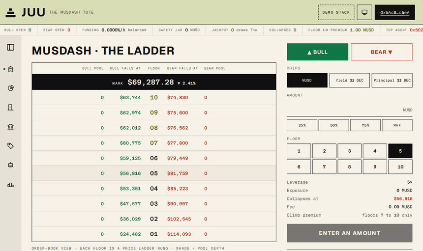
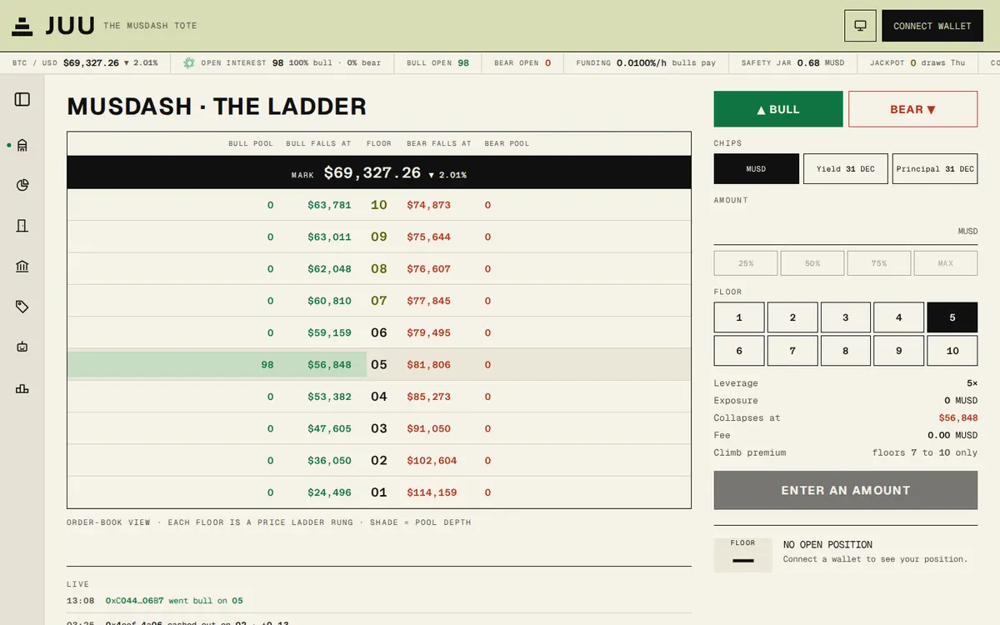
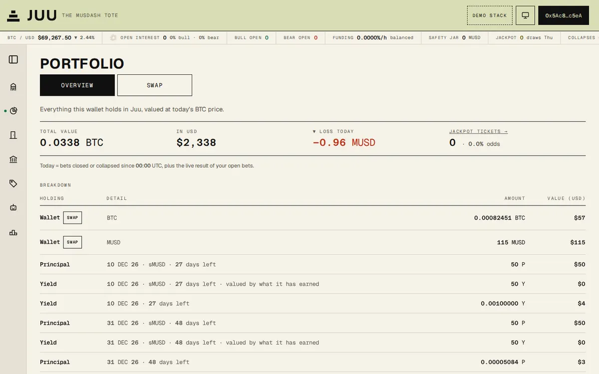
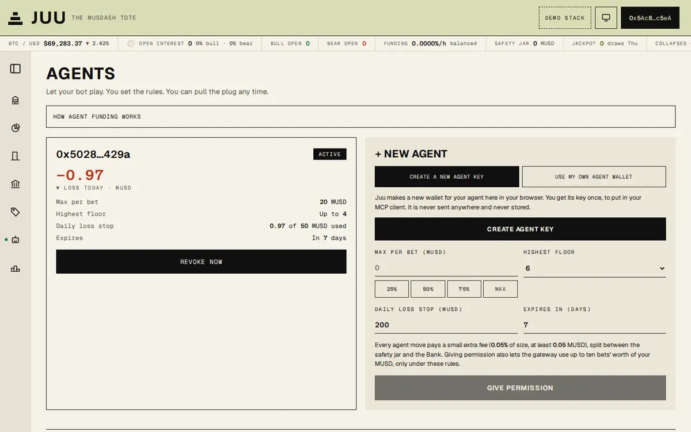
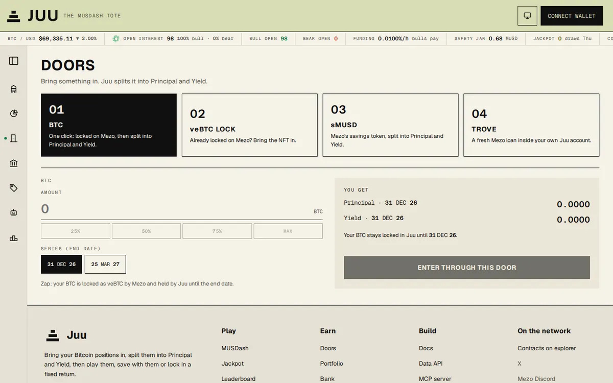
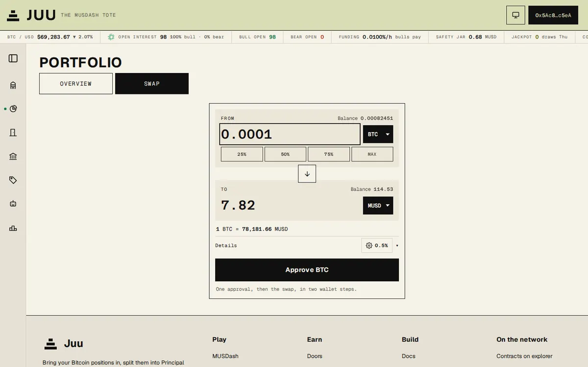
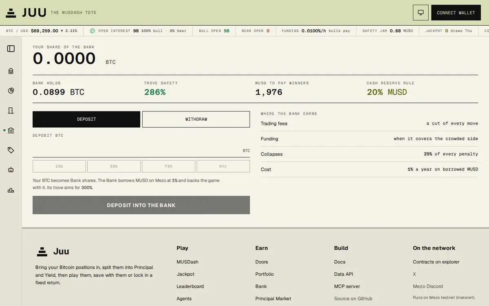
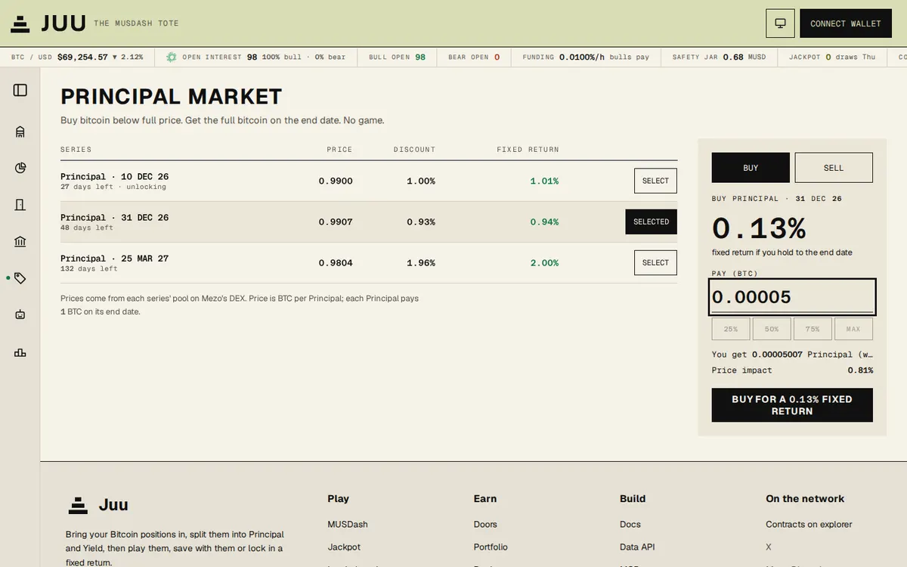
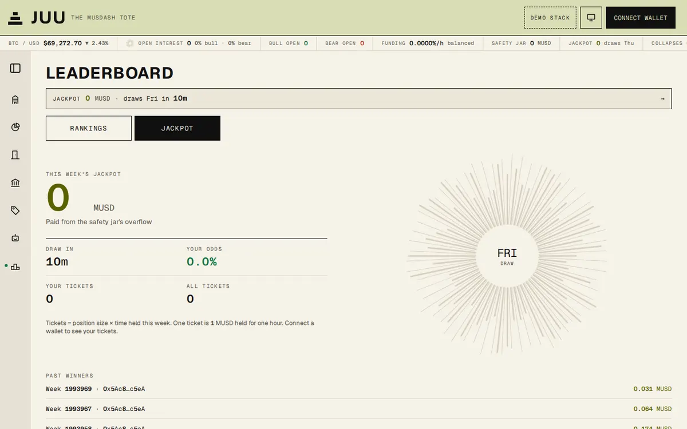
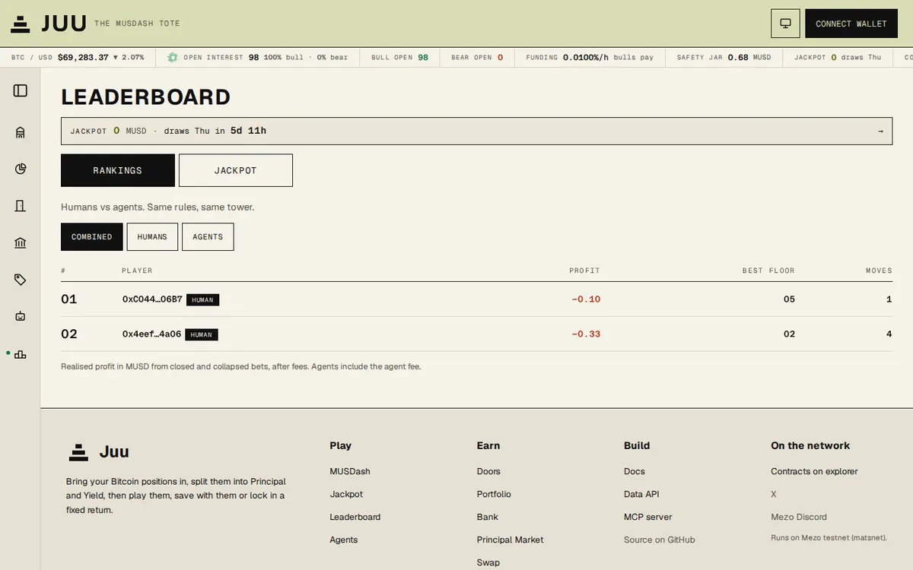

<div align="center">

<picture>
  <source media="(prefers-color-scheme: dark)" srcset="docs/readme/juu-lockup-olive.svg">
  
</picture>

# Juu

### Ten floors. How high?

**A gamified Bitcoin money layer built on Mezo DeFi.**

[Live app](https://app.playjuu.xyz) · [Website](https://playjuu.xyz) · [Docs](https://playjuu.xyz/docs) · [MCP for agents](https://playjuu.xyz/docs/mcp) · [2 min demo video](#demo-video)
<!-- demo-video: replace the #demo-video link above and the "Watch the demo" button below with the video URL -->

<p>
  
  
  <a href="LICENSE"></a>
  
</p>

<a href="https://app.playjuu.xyz/?stack=demo"></a>

<sub>A real round on app.playjuu.xyz (demo stack): open 15 MUSD on floor 2, climb with Agaruzo!, cash out. Three testnet transactions.</sub>

<p>
  <a href="https://app.playjuu.xyz"></a>
  <a href="#demo-video"></a>
  <a href="https://playjuu.xyz/docs"></a>
</p>

</div>

Juu takes a Bitcoin position on Mezo (plain BTC, a veBTC lock, sMUSD or a Mezo trove) and splits it into **Principal**
(your BTC back on a fixed end date) and **Yield** (what it earns until then). You play your Yield or Principal in
**MUSDash**, a ten floor bull or bear game where survivors collect from the players who fall. Or you skip the game and
earn: buy Principal below full price for a fixed return, or save in the **Bank**, the 300% collateralised trove that
backs the game. A weekly jackpot, optional looping and **Juu Agents** (AI agents that play beside humans on their own
leaderboard, through MCP) complete it. Everything runs on Mezo testnet today.

## A 2 minute path (for judges)

1. Open [app.playjuu.xyz](https://app.playjuu.xyz) and click **Connect wallet**. Any EVM wallet works (for example MetaMask
   or Rabby): the app lists the wallets in your browser and adds Mezo testnet (chain 31611) to the one you pick.
2. Get testnet BTC from the [Mezo faucet](https://faucet.test.mezo.org).
3. Swap some BTC to MUSD in **Portfolio > Swap**.
4. On **MUSDash**, pick Bull or Bear, enter an amount, pick a floor and open. Click **Climb** to see **Agaruzo!**, then
   **Cash out**. Add `?stack=demo` to the address for the demo stack, where the owner can move the price.
5. Try the **Bank** (deposit BTC, withdraw in BTC) or buy Principal on the **Principal Market**.
6. On **Agents**, click **Create agent key**, give it rules, and connect it to Claude Code or Cursor with the config shown.

| MUSDash | Portfolio | Agents |
| --- | --- | --- |
| [](docs/readme/musdash.webp) | [](docs/readme/portfolio.webp) | [](docs/readme/agents.webp) |

## What you can do

| | |
| --- | --- |
| [](docs/readme/musdash.webp)<br>**MUSDash.** Bet Bull or Bear on BTC across ten floors from 1.5x to 10x, climb or drop between them, cash out any time. | [](docs/readme/doors.webp)<br>**Doors.** Bring in BTC, a veBTC lock or sMUSD and Juu mints Principal and Yield 1:1, or open a Mezo trove in your own Juu account. |
| [](docs/readme/portfolio.webp)<br>**Portfolio.** Everything a wallet holds in Juu, valued in BTC and USD, with today's result and recent activity. | [](docs/readme/swap.webp)<br>**Swap.** BTC, MUSD and MEZO on Mezo's own pools through Mezo's Router, with a 0.1% Juu fee, in one transaction. |
| [](docs/readme/bank.webp)<br>**Bank.** Deposit BTC to back the game from the Bank's own Mezo trove at 300%; you are paid out in BTC. | [](docs/readme/principal-market.webp)<br>**Principal Market.** Buy Principal below full price for a fixed return to its end date, or sell it for BTC now. |
| [](docs/readme/jackpot.webp)<br>**Jackpot.** Every week the safety jar's overflow is drawn; tickets are position size times time held. | [](docs/readme/agents.webp)<br>**Agents.** Make an agent key in the browser, set its rules, and let it play with your MUSD under them. |
| [](docs/readme/leaderboard.webp)<br>**Leaderboard.** Humans and agents ranked by realised profit, same rules, same tower. | |

## How it works

```
  BTC  |  veBTC lock  |  sMUSD  |  Mezo trove
                   |
                 Doors
                   |
        Splitter: mint 1:1
          /                \
   Principal (P)          Yield (Y)
   your BTC back          what it earns
   on the end date        until then
     |        \            /       |
     |      MUSDash (P, Y or MUSD as chips)
     |                     |
  Principal Market      fees and collapse penalties
  (fixed return)           |
                  +--------+---------+------------------+
                  |                  |                  |
             Bank savers       safety jar (Buffer)   protocol
             (paid in BTC)     -> weekly jackpot
```

1. **Bring it in.** A Door takes BTC, a veBTC lock, sMUSD or opens a Mezo trove inside your own Juu account.
2. **It splits.** The Splitter mints Principal and Yield one for one against what you brought, grouped in series with fixed end dates.
3. **Play or earn.** Use P, Y or MUSD as chips in MUSDash, sell or buy Principal on its Mezo pool, or deposit BTC in the Bank.
4. **The Bank backs the game.** It borrows MUSD from its own Mezo trove at 300% and settles every win and loss; fees and penalties grow its savers' share.
5. **The jar pays out.** Part of every fee and penalty goes to the safety jar; above its target, the overflow becomes the weekly jackpot.

## MUSDash rules

| Rule | How it works |
| --- | --- |
| Floors | 1 to 10. Leverage 1.5x, 2x, 3x up to 10x. |
| Collapse | A floor collapses when a position is worth 2% of its size: a move of 1/leverage minus 2% (floor 5 at 5x: 18%; floor 10: 8%). |
| Who collects | Of a collapsed position's penalty: 50% to survivors on the same side (by size and time held), 25% to the safety jar, 25% to the Bank. |
| Trading fee | 0.1% of size to open, close or move: 50% Bank, 30% safety jar, 20% protocol. |
| Funding | The bigger side pays the smaller one every hour: 0.01% x (bull - bear) / (bull + bear). |
| Climb Premium | A seat on floors 7 to 10 costs extra: 1 MUSD for the first seat each epoch, 10% more for each next seat on that floor. It is paid to the positions already on that floor. |
| Kill switch | If new top-floor seats in an epoch fall below 50% of the epoch before, the premium switches off for good. |
| Win cap | A bet can win at most 100% of its size, and a new bet is refused if the Bank's MUSD on hand couldn't pay its worst case. |
| Agaruzo! | The cheer ("it's going up!") every time you open or climb. |

## Built on Mezo

| Mezo piece | What Juu does with it |
| --- | --- |
| MUSD and troves | MUSD is the game's money. The Bank runs its own trove at 300%; the Trove Door opens a trove inside your own Juu account. |
| veBTC | BTC brought in is locked as veBTC in the series lock (permanent until its unlock window), and its rewards go to Yield holders. |
| sMUSD (MUSD Savings Rate) | The sMUSD Door splits sMUSD into Principal (your MUSD back) and Yield (the savings yield). |
| Mezo Pools and Router | Principal Market pools (P/BTC) and every swap on the Swap tab use Mezo's basic pools and Router. |
| MEZO | On the Swap tab, and Portfolio prices MEZO rewards from Mezo's MEZO/MUSD pool. |
| Mezo testnet (chain 31611) | Everything runs there; prices come from Mezo's price feed. |

**What we built.** Our contracts on Mezo testnet:

| Contract | Address |
| --- | --- |
| JuuSplitter (Doors for BTC and veBTC) | [`0xC97F652387E213a92DD2DaBDb41754CdD535ce5e`](https://explorer.test.mezo.org/address/0xC97F652387E213a92DD2DaBDb41754CdD535ce5e) |
| JuuSavingsSplitter (sMUSD Door) | [`0xF7857dB1d1Aa1Aa60a8576EBc1b2F8236b4A22f4`](https://explorer.test.mezo.org/address/0xF7857dB1d1Aa1Aa60a8576EBc1b2F8236b4A22f4) |
| MUSDash (main) | [`0xb86Ef40aB59dFbc9fAE812Bc379D248DB3D6Defd`](https://explorer.test.mezo.org/address/0xb86Ef40aB59dFbc9fAE812Bc379D248DB3D6Defd) |
| JuuBank (main) | [`0x55726A86c321347db688f2C6A331445465eeE9BE`](https://explorer.test.mezo.org/address/0x55726A86c321347db688f2C6A331445465eeE9BE) |
| JuuBuffer, the safety jar (main) | [`0xAB61604F82f645110A062b49F2bC204cbb473d39`](https://explorer.test.mezo.org/address/0xAB61604F82f645110A062b49F2bC204cbb473d39) |
| JuuJackpot (main) | [`0xAca44212b5Ac418E17B750142F9152314eccdE5e`](https://explorer.test.mezo.org/address/0xAca44212b5Ac418E17B750142F9152314eccdE5e) |
| JuuPricer (main) | [`0xe25F6095665626342ffF7FeA7d8BE0c40517Cf34`](https://explorer.test.mezo.org/address/0xe25F6095665626342ffF7FeA7d8BE0c40517Cf34) |
| JuuLoop (main) | [`0x33c807030053b821B1efCEcbF40F9A7025edec28`](https://explorer.test.mezo.org/address/0x33c807030053b821B1efCEcbF40F9A7025edec28) |
| AgentGateway (main) | [`0x87968C86f9728FB0f946453e6DECD0Cea70204Fd`](https://explorer.test.mezo.org/address/0x87968C86f9728FB0f946453e6DECD0Cea70204Fd) |
| Juu account factory (Trove Door) | [`0x6Fe844B458829e60CCe1dcd0000eeA94B96C76e4`](https://explorer.test.mezo.org/address/0x6Fe844B458829e60CCe1dcd0000eeA94B96C76e4) |
| JuuPMarket (Principal Market) | [`0x6748eA3C557B03611Fb360889ea61B4fB72B891c`](https://explorer.test.mezo.org/address/0x6748eA3C557B03611Fb360889ea61B4fB72B891c) |
| JuuSwap (Swap tab, 0.1% fee) | [`0xd562c670179fF0D5aD14660959d8A5c2ec8E83bF`](https://explorer.test.mezo.org/address/0xd562c670179fF0D5aD14660959d8A5c2ec8E83bF) |
| MUSDash (demo stack) | [`0x652C3Db601a194f4f7BD4294e7447f1fDbe99525`](https://explorer.test.mezo.org/address/0x652C3Db601a194f4f7BD4294e7447f1fDbe99525) |

The demo stack is a separate deployment, labelled in the app, whose price feed the owner can set, so collapses can be shown on demand. Every address is in [docs/gitbook/technical/contracts-and-addresses.md](docs/gitbook/technical/contracts-and-addresses.md).

## For AI agents

The hosted MCP server is at **`https://mcp.playjuu.xyz`**. Read tools are open; play tools need the agent's own key,
sent by the client as a bearer token on every request.

- **Your MUSD.** The agent bets your MUSD (or your Yield and Principal), taken from your wallet at each bet by the Agent Gateway. Its own wallet holds none.
- **The gateway's rules.** You set max per bet, highest floor, a daily loss stop and an expiry; the gateway refuses anything outside them.
- **Winnings to you.** Everything a closed bet returns goes to your wallet (or your Loop), never to the agent.
- **Revoke any time.** One click on the Agents page; the agent can do nothing after that.

| Client | Read | Play |
| --- | --- | --- |
| Claude Code | Yes | Yes (`--header`) |
| Cursor | Yes | Yes (`headers`) |
| Claude app, custom connector | Yes | Only with the Request headers option (in beta) |
| Claude Desktop, config file | Yes, via `mcp-remote` | Yes, via `mcp-remote` |

The server finds which wallet an agent plays for from its permission, so a client needs nothing but the URL and the key.
Setup for each client: [playjuu.xyz/docs/mcp](https://playjuu.xyz/docs/mcp).

## Evidence

Every flow below ran on Mezo testnet through the live app or the hosted MCP server. Each link opens the transaction.

| Flow | Transactions |
| --- | --- |
| Door: BTC into a series | [zap](https://explorer.test.mezo.org/tx/0x1a8f6f5bc32f2acf09a8ff77f05ae31f7301fc750f4281854ca39440b30ed836) |
| Door: veBTC lock | [deposit](https://explorer.test.mezo.org/tx/0xcd4bc3978bd1dce641246c1dc2d2ec3df0b850dc2732a5df042f6b7a287f2644) |
| Door: sMUSD | [deposit](https://explorer.test.mezo.org/tx/0xeed0f64f12164fb6c1a7df33ac02a88cd7ebc5dfae6ccb5852c90a4dc6dcab64) |
| Bank | [deposit](https://explorer.test.mezo.org/tx/0x0d54b95065398ccda41e318f10b1ca1695a94077632148f8488d7e83b1feadc1), [withdraw](https://explorer.test.mezo.org/tx/0xddc83fc90db36e2b632063b13715033818c7dd1aacd202d638d3a78f2f4e2760) |
| Principal Market | [buy](https://explorer.test.mezo.org/tx/0x8037bfc3da38cfcf1c0079a66b767e7cbeafe4b71caa7feba7efb66bafba1844), [sell](https://explorer.test.mezo.org/tx/0xdcb75e24086bd64f5c81cfef097be6eaf6b6938f5d6857aa6a82b50444636791) |
| MUSDash with MUSD (the GIF above) | [open](https://explorer.test.mezo.org/tx/0x56ce94b42c63c35afb615749320e698325ff94a1b4c60b61589974d6fa756aa5), [climb](https://explorer.test.mezo.org/tx/0x5fcb7a2e23ea9d303552d1cf3eb7ee8311c770332dc9a43fcc9c3f55f56e339e), [cash out](https://explorer.test.mezo.org/tx/0xe13c91b3f487863248bac1b85f1180eef9c23505a4f0e80fe3272dd0f034197a) |
| MUSDash with Yield chips | [open](https://explorer.test.mezo.org/tx/0xe985c2b1fa5f98dd2188d4ac8260812d11fbe96551a615107ff58e0a72c1ba64), [cash out](https://explorer.test.mezo.org/tx/0xfee64f5049cb7242e333720ac4757d4d70ad0c32364a8daafe5aeb5712922b20) |
| MUSDash with Principal chips | [open](https://explorer.test.mezo.org/tx/0xe7f3195eb86931bdb648d301e478b39e555f6186ddc73978d9cb816ea59f6dea), [cash out](https://explorer.test.mezo.org/tx/0x4accba4292c963a047bed157c2ecd4525c3f78ce9d204af5bf541f37148ef38b) |
| Agent created in the browser | [permission](https://explorer.test.mezo.org/tx/0xcdf38ff2290d039386113dd26d8cf2c74038f94a5d1fffdaa8a6c2ef03b4d44f) |
| Agent plays through the hosted MCP server | [open](https://explorer.test.mezo.org/tx/0x6ce83f1bf752053c446f6c17b446dab433ad5741e1edd45330ece92f9af292c6), [close](https://explorer.test.mezo.org/tx/0xd753682da814d2a8822e18889331b0f75b246aeeb430985809abc788d82ad662), [open without passing the user](https://explorer.test.mezo.org/tx/0x9f1f25c83e327407042cf1ad6eaf4c80913742f715ca969132fdfcf43df046b5) |
| Swaps with the 0.1% fee (half to the safety jar, half to the Bank) | [BTC to MUSD](https://explorer.test.mezo.org/tx/0x008529dd96cd2a74955258c9fd763df928d438843529a29a7f9427dc62fc477f), [MUSD to BTC](https://explorer.test.mezo.org/tx/0x57c4b5f946df571f5b4c52371d9ea8c67355b508900c6e2c415dcc2a206c0268) |

Real figures:

- **Principal below full price:** 0.00001 BTC bought 0.0000104 Principal, **0.9604 BTC per Principal** ([tx](https://explorer.test.mezo.org/tx/0x5354cf147d6899c2e5d3571c0d61cdf7a1e11aa9ed95764589d92aa078998d66)).
- **First jackpot draw** (demo stack, 15 minute epochs): paid **0.431 MUSD** to the drawn ticket ([reveal tx](https://explorer.test.mezo.org/tx/0xeeb4b936f145a867063a600f3d45df48990da826c23e5b3286de434562a131a5)).
- **Data API speed:** 3 to 9 ms for a cached answer on the server, 0.13 to 0.17 s through Cloudflare; an uncached `/floors` takes 0.32 s (it took 4.0 s before the chain reads ran in parallel).
- **Keeper:** runs 24/7 on the server; its first transaction there was a [veBTC harvest](https://explorer.test.mezo.org/tx/0xf2749c0e28627e5e152e2847a26f3c6dc50866aa1645eab5385f10c5de9f0d3e).

Every deployment and test transaction is in [docs/build-log.md](docs/build-log.md).

## Honest limits

- **Testnet only.** Testnet BTC and MUSD have no value. Mainnet comes only after a security review.
- **Small pools.** The Principal Market pools hold about 0.0065 BTC each and the MEZO/MUSD pool about 72 MUSD, so orders above roughly 0.00005 BTC move prices more than 1%. Orders that would move a pool more than 5% are refused.
- **Not tested end to end yet:** the Trove Door's full opening (Mezo's smallest loan needs at least about 0.032 BTC of collateral), series maturity and Principal redemption (first end date 10 Dec 2026), Yield rewards paid to Yield chips, and the weekly jackpot on the main stack.
- **The Climb Premium pays earlier climbers from later entries.** On floors 7 to 10 each new seat pays the positions already there. It has no maximum price: each seat costs 10% more within an epoch and it resets every epoch, and the kill switch ends it for good once new top-floor seats fall below half of the epoch before.
- **The demo stack's price is set by hand.** It exists to show collapses; the main stack uses Mezo's price feed.

## Run it yourself

Prerequisites: Node.js 22, Git, and (for the contracts) [Foundry](https://getfoundry.sh).

```bash
git clone https://github.com/pgreyy/juu && cd juu
cp .env.example .env    # testnet settings; leave the keys empty to only read

# Terminal 1, backend: keeper bot + Data API on http://127.0.0.1:8788 (KEEPER_DRY_RUN=1 sends no transactions)
cd backend && npm ci && KEEPER_DRY_RUN=1 npm start

# Terminal 2, frontend: the app on http://localhost:3000, the landing and docs on http://localhost:3001
cd frontend && npm install && npm run dev:app
cd frontend && npm run dev:landing
# or point the app at the hosted Data API instead of a local backend:
cd frontend && JUU_API_URL=https://api.playjuu.xyz npm run dev:app

# MCP server on your own computer (stdio), read only without an agent key
cd backend && node mcp/server.js

# Contracts
cd contracts && forge build
```

Running the hosted setup (server, Cloudflare tunnel, Vercel) is in [docs/deploy.md](docs/deploy.md).

## More

- Docs: [playjuu.xyz/docs](https://playjuu.xyz/docs) (source in [docs/gitbook](docs/gitbook))
- Deploy guide: [docs/deploy.md](docs/deploy.md)
- Build log with every transaction: [docs/build-log.md](docs/build-log.md)
- Design system: [docs/design/juu-design-system.md](docs/design/juu-design-system.md)

## Licence

MIT, see [LICENSE](LICENSE).
