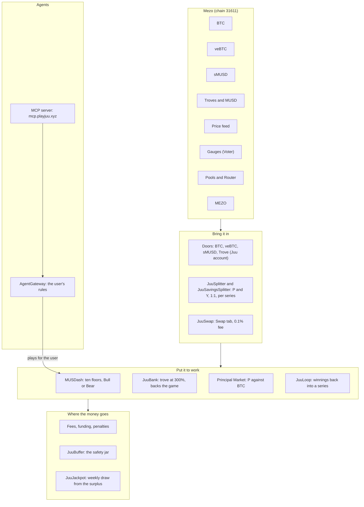
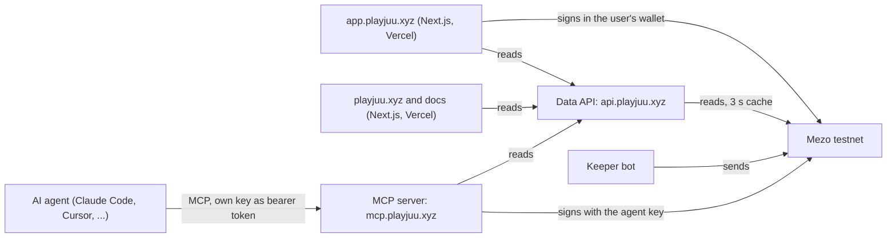
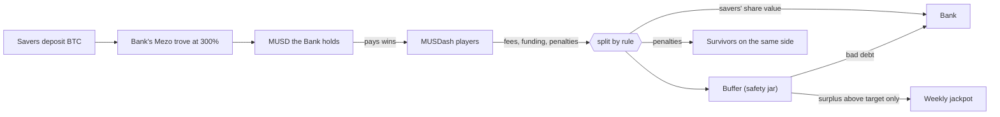

# Architecture

How Juu connects to Mezo, how its contracts connect to each other, and what runs off chain. Addresses are in
[gitbook/technical/contracts-and-addresses.md](gitbook/technical/contracts-and-addresses.md); the transactions that show
each part working are in [evidence.md](evidence.md).

## The layers

## On chain

| Contract | What it does | Mezo pieces it uses |
| --- | --- | --- |
| JuuSplitter | BTC and veBTC Doors. Locks BTC as veBTC in one lock per series (permanent until the unlock window), mints Principal (P) and Yield (Y) 1:1, votes the locks, harvests their rewards for Y, unlocks and matures each series. | veBTC, Voter (gauges), RewardsDistributor |
| JuuSavingsSplitter | sMUSD Door: P is your MUSD back on the end date, Y is the savings yield. | sMUSD |
| JuuAccountFactory and JuuAccount | Trove Door: a Mezo trove inside the user's own Juu account. Bets can borrow from it; returned chips repay the debt; profit becomes BTC collateral; a guard closes bets when the trove gets too close to its limit. | BorrowerOperations, TroveManager, Router |
| JuuPricer | Values P and Y as chips: Y from the weekly yield the keeper reports, both with haircuts. | Price feed, TroveManager |
| MUSDash | The game: ten floors (1.5x to 10x), Bull or Bear, MUSD, P or Y chips, funding, collapses, survivor rewards, the Climb Premium on floors 7 to 10, jackpot tickets. | Price feed (main stack) |
| JuuBank | Savers deposit BTC; the Bank runs one trove at 300% and pays winners in MUSD. A cash reserve and a per bet cash check keep wins payable. | Troves and MUSD |
| JuuBuffer | The safety jar: gets part of fees and penalties, covers bad debt, pays the jackpot from its surplus above target. | MUSD |
| JuuJackpot | Weekly commit and reveal draw over tickets (position size x time held). | |
| JuuPMarket | Principal Market: P against BTC on Mezo pools; quotes the fixed return to the end date. | Pools and Router |
| JuuLoop | Optional: swaps winnings to BTC and zaps them back into a series. | Router |
| JuuSwap | Swap tab: takes a 0.1% fee (cap 0.5%), turns it into MUSD, half to the Buffer and half to the Bank, then swaps through Mezo's Router. | Pools and Router, MEZO |
| AgentGateway | Holds agent positions for their users and enforces each user's rules: max per bet, highest floor, a daily realised loss stop, expiry, revoke. | |
| DemoPriceFeed (DEMO ONLY) | The demo stack's price: Mezo's price unless the owner sets one, so a collapse can be shown on demand. Not used by the main stack. | Price feed |

There are two stacks: **main** (Mezo's price feed) and **demo** (DemoPriceFeed, 15 minute epochs). They share the
Splitter, the series and the Principal Market, and have their own MUSDash, Bank, Buffer, Jackpot, Loop and Gateway.

## Off chain

* **Keeper bot** (backend, one process with the Data API): collapses floors that are due, runs funding, harvests and
  reports yield, votes, starts each series' unlock and matures it, checks the Climb Premium kill switch, commits and
  reveals the jackpot, rebalances the Banks and runs the trove guards. Anyone can call the time critical steps; the
  keeper makes sure they happen on time.
* **Data API**: read only JSON over the contracts (floors, positions, series, Bank, jackpot, leaderboard, portfolio),
  with a shared 3 second cache. The only write is a signed request to hide a revoked agent from the app.
* **MCP server**: read tools are open; play tools need the agent's own key, sent as a bearer token on each request and
  used only to sign that request's transactions. The AgentGateway decides what the agent may do.
* **Hosting**: the backend and MCP server run on one server behind a Cloudflare tunnel; the app and the landing page
  are on Vercel.

## Money flow

| Money | Where it goes |
| --- | --- |
| Trading fee, 0.1% of size | 50% Bank, 30% Buffer, 20% protocol |
| Collapse penalty | 50% survivors on the same side (by size and time held), 25% Buffer, 25% Bank |
| A collapsed position's loss | the Bank |
| Funding | the bigger side pays the smaller side every hour; funding on the gap goes to the Bank |
| Climb Premium (floors 7 to 10) | the positions already on that floor (the Bank if the floor is empty) |
| Agent fee, 0.05 MUSD per agent move | half Bank, half Buffer |
| Swap fee, 0.1% | turned into MUSD, half Buffer, half Bank |
| Jackpot | only the Buffer's surplus above its target (5% of open positions) |
